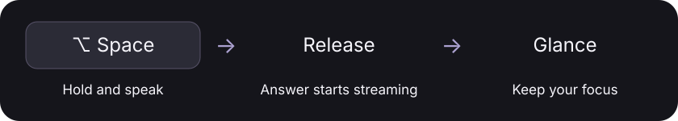

# Psst

**Hold a shortcut. Ask a question. Glance at the answer.**

Psst is a native macOS menu bar app for quick voice-to-AI answers. Speech recognition and answer generation run on your Mac, using Apple’s Speech and Foundation Models frameworks. No API key, account, or cloud inference service.


## How it works



1. Hold **Option–Space** and speak. A small, fluid orb appears at the top right, with a live transcript.
2. Release to submit. The orb animates while thinking, and the response streams into the glass popup.
3. Dismiss with **Esc**, the close button, or a click outside. Your current app keeps keyboard focus.

Quick accidental taps under **0.4 seconds** cancel silently. Esc cancels recording or generation immediately. Answers also dismiss automatically after 22 seconds.

## Features

- On-device speech recognition and language model inference.
- Live transcript so you can check what was heard.
- Streaming answers, readable equations, Markdown emphasis, and bullets.
- Glass popup and voice-reactive orb, with Reduce Motion support.
- Global shortcut interception, multiple displays, fullscreen apps, and Launch at Login.
- No saved audio, conversation history, or analytics during normal use.

## Requirements

- macOS 26 or newer on a Mac that supports Apple Intelligence.
- Apple Intelligence enabled and its on-device model downloaded.
- Microphone, Speech Recognition, and Accessibility permission for Psst. Accessibility lets the app consume Option–Space before it reaches other apps.
- Apple on-device speech recognition available for your current language. If unavailable, enable that language for Dictation in System Settings → Keyboard.
- macOS must permit event interception in the current session. Secure Input/password fields and OS-protected input remain controlled by macOS.

## Build and run

```sh
git clone https://github.com/adamzafir/psst.git
cd psst
./scripts/build.sh --install
open ~/Applications/Psst.app
```

Requires Swift 6.2 or later and the macOS 26+ SDK. Xcode is optional when compatible Command Line Tools are installed. Open `Package.swift` in Xcode to work on the source, but use the build script to produce the runnable `.app` with its privacy descriptions. The script uses local ad-hoc signing; distribution to other Macs requires your own Developer ID signing and notarization.

The first launch requests permissions and registers Launch at Login using `SMAppService`. You can disable it in Psst’s menu. If macOS requires login-item approval, approve Psst in System Settings → General → Login Items. Psst has no Dock icon; use its waveform menu bar icon to set up permissions, retry shortcut interception, preview the answer panel, or quit.

## Performance and limitations

Psst prewarms the model and streams text as soon as it arrives. It does **not** guarantee an answer in one or two seconds: nine local trials on an M2 MacBook Air with Low Power Mode enabled measured a **2.44-second median** to first text, with a **1.78–6.48-second range**. See [measurements and methodology](PERFORMANCE.md).

Apple’s on-device model has no web access and can give incorrect answers. Math formatting supports common notation; it is not a full TeX renderer. macOS Secure Input and protected system shortcuts cannot be overridden.

## Development

```sh
./scripts/test.sh
./scripts/build.sh
```

See [architecture, diagnostics, and manual checks](docs/DEVELOPMENT.md). The regression suite covers shortcut handling, cancellation, streaming, and answer formatting. Synthetic speech benchmarks do not record the microphone.

Screenshots show the app’s built-in previews with sample questions and answers.
